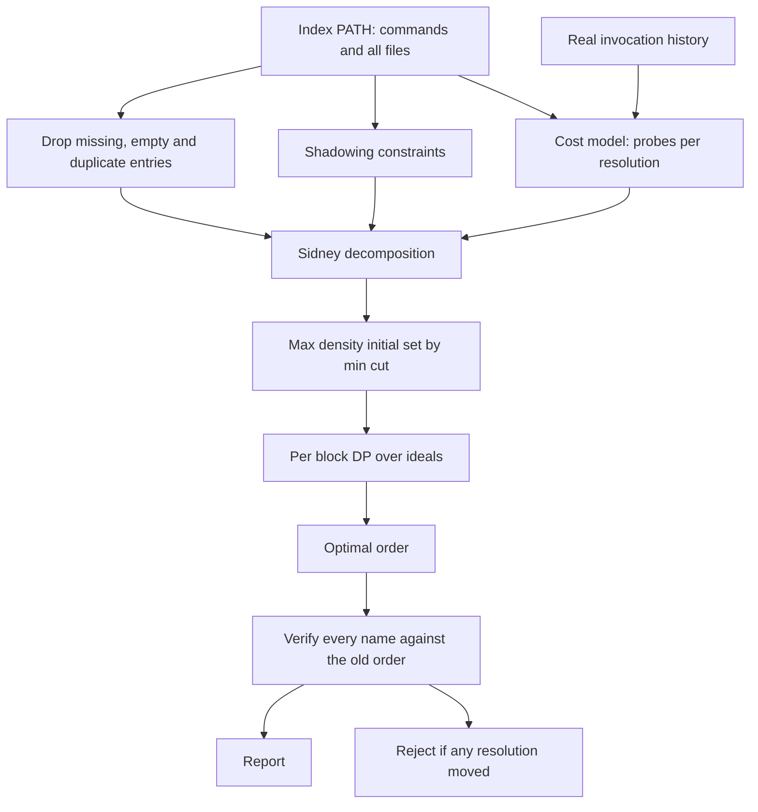
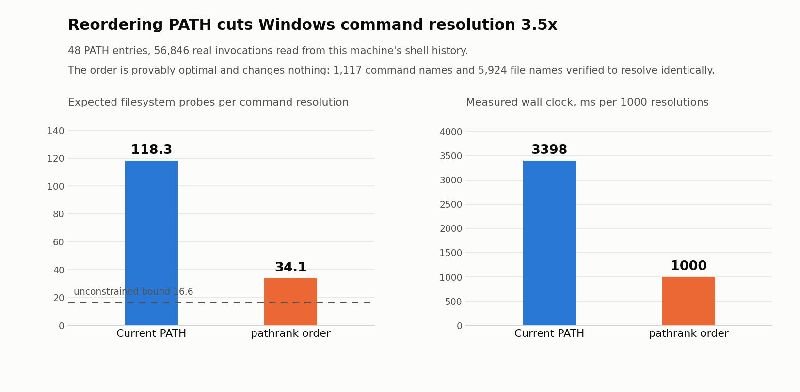

# pathrank

Finds the provably cheapest order for your Windows PATH, and proves it changes nothing.

## The problem

Every time a shell runs a bare command name, it searches PATH the same way: for
each directory in order, try the name with each PATHEXT extension, stop at the
first file that exists. A directory that does not hold the command therefore
costs one failed filesystem probe per extension. With 14 extensions in PATHEXT,
every directory you scan past costs 14 probes.

Nobody orders PATH. It is an accretion: installers append, tools prepend, and
entries survive long after the software is gone. On the machine this was built
on, PATH had 48 entries, 6 of which no longer exist, 1 with no files in it, and
8 that were second spellings of a directory already listed earlier. The
directory answering more than half of all invocations sat in position 20.

That ordering is not free. A failed existence probe measured 31.88 microseconds
here, which is what a filesystem filter driver costs on a path that does not
exist. At 118 probes per resolution, every command a script runs pays about 3.4
milliseconds before the process even starts.

The obvious fix is to put the directories you use first. The reason nobody ships
that fix is that reordering PATH silently changes which file wins when two
directories hold the same name, and PATH is searched for DLLs and data files,
not just executables. Getting it wrong moves a dependency out from under a
running program.

## What it does

pathrank reads your PATH, your PATHEXT, and your real shell history, then
returns the PATH order with the lowest expected probe count among all orders
that resolve every single name exactly as today.

1. **Inventory.** Scan every PATH directory and index every file it holds, not
   only the executable ones.
2. **Workload.** Count real invocations from PSReadLine history, bash history,
   and recorded agent tool calls. No synthetic distribution.
3. **Safe reductions.** Drop entries that provably cannot change a resolution:
   unreadable directories, directories with no files, and later spellings of a
   directory already on PATH.
4. **Constraints.** For every name held by more than one directory, the
   directory that wins it today must stay ahead of the others.
5. **Exact solve.** Minimise expected probes subject to those constraints.
6. **Verify.** Re-resolve every command name and every file name under the new
   order, and cross-check against the operating system through `shutil.which`.
   If anything moved, the order is rejected rather than reported.

It never modifies your environment. It prints the order and lets you apply it.

## Why it is interesting

**The cost function collapses to a textbook problem.** Expected probes is
`len(PATHEXT) * sum_D w_D * position(D)` plus a term independent of order, where
`w_D` is the share of invocations directory `D` answers. Minimising that under
the shadowing constraints is exactly `1|prec|sum w_j C_j` with unit processing
times: single machine weighted completion time with precedence. That problem is
NP-hard in general, but it has an exact theory nobody has pointed at PATH.

**So it is solved exactly, not heuristically.** Sidney decomposition repeatedly
peels off the initial set of maximum density `w(S)/|S|`, which is found exactly
by maximum-weight closure, computed as a min-cut and driven by Dinkelbach
iteration. Sidney's theorem says those blocks keep their relative order in some
optimal schedule, so each block can then be ordered exactly by dynamic
programming over the ideals of its induced order. On the real instance the
decomposition produced 31 blocks, the largest holding 2 directories, and every
block was solved exactly. The solver is checked against brute force over all
feasible permutations on 120 random instances, where it matched the optimum
every time.

**The naive version of this optimisation is unsafe, and the tool shows it.**
Constraining only executable names reaches 28.02 expected probes, better than
the 34.08 that full safety allows. It also moves 12 non-executable resolutions,
among them `msvcp140.dll`, `msvcp140_1.dll`, `msvcp140_2.dll` and `mfc140u.dll`,
which shift from the ImageMagick directory to `system32`. Those are DLLs that
processes load through PATH. The faster order is a dependency change wearing a
performance costume, so pathrank rejects it and reports the slower, correct one.

**The cost model is validated, not assumed.** Multiplying the predicted probe
count by the measured per-probe cost predicts 3.77 ms per resolution. Direct
measurement of the same workload gives 3.40 ms, an 11.0 percent error, which is
close enough to treat probe count as the real currency.

## Architecture

[FigJam board](https://www.figma.com/board/zarf7AUvrt49MqXpuG4zYj)

The diagram shows how the PATH inventory and the real invocation history feed a
cost model and a constraint set, how the exact solver turns those into an
optimal order, and how the verifier gates that order before it is ever reported.



## Results



The metric is the cost of resolving one bare command name through PATH, shown
two ways. The left panel counts filesystem existence probes, which is exact and
machine independent. The right panel is wall clock, measured by actually
resolving a sampled invocation stream against the real filesystem.

The baseline is the PATH this machine actually had: 48 entries, untouched. The
workload is 56,846 real invocations of 231 distinct commands, read from 644
lines of PowerShell history and 56,202 recorded agent tool calls. Nothing is
simulated.

Reordering takes expected probes from **118.28 to 34.08**, a 3.47x reduction,
and measured wall clock from **3398.3 to 999.7 ms per 1000 resolutions**, a
3.40x reduction. Timings are taken round-robin across both orders and reported
as the minimum of 7 rounds, because desktop filesystem caching drifts over the
span of a benchmark and a sequential A-then-B layout would charge that drift to
whichever order ran second.

The dashed line at 16.56 is the cost if directories could be ordered purely by
weight, ignoring which names they shadow. The gap between it and 34.08 is the
real price of correctness on this machine: keeping `Git\mingw64\bin` ahead of
`Git\usr\bin`, which is forced by 19 shared names, costs more than half the
remaining headroom. That gap is a measurement, not a failure, and the solver
proves nothing below 34.08 is reachable without changing a resolution.

Most of the win is structural rather than clever. 15 of the 48 entries were
removable with no effect at all: 6 pointed at directories that do not exist, 1
held no files, and 8 were duplicate spellings of a directory already on PATH.
Each one of those was costing 14 probes on every command that had to scan past
it.

## How to run it

Requires Python 3.9 or newer on Windows. The only dependency is matplotlib, and
only for the chart.

```
git clone https://github.com/joelvarun/pathrank
cd pathrank
pip install -r requirements.txt
python demo.py
```

`demo.py` analyses the PATH of the shell you run it in, solves it, verifies the
result, measures both orders, and writes `docs/before_after.png`.

```
python demo.py --no-bench     skip the wall-clock measurement, analysis only
python demo.py --uniform      ignore history, weight every command equally
python demo.py --rounds 11    more timing rounds
```

Check the solver against brute force:

```
python tests/test_optimality.py
```

Use it as a library:

```python
from pathrank import inventory, solve, verify, workload

inv = inventory.build()
weights, sources = workload.collect(inv)
result = solve.solve(inv, weights, strict=True)
report = verify.check(inv, result.order, result.edges)

assert report.ok and result.optimal
print(inv.path_value(result.order))
```

pathrank never writes to your environment. To try the order for one shell
session, paste the `$env:PATH` line it prints. To keep it, set it through
System Properties or `setx`, and keep the old value somewhere first.

## Example output

A real run on the machine this was built on:

```
1. PATH inventory
PATH entries          48
PATHEXT extensions    14  (.com .exe .bat .cmd .vbs .vbe .js .jse .wsf .wsh .msc .py .pyw .cpl)
resolvable commands   1117
distinct file names   5924
commands present in more than one directory   969

2. Invocation workload
invocations           56,846 over 231 distinct commands
  agent_transcripts      56,202
  powershell_history     644
  most invoked:        print (8650), python (6773), echo (3718), grep (3702), head (2435)

3. Exact solve, preserving every resolution
provably removable entries   missing 6, file free 1, duplicate 8
shadowing constraints        19 precedence edges
Sidney blocks                31 (largest 2)
every block solved exactly   True
expected probes  before      118.28
expected probes  after       34.08
unconstrained lower bound    16.56
reduction                    3.47x fewer probes

4. Verification
PASS: 1117 command names, 5924 file names, 1117 operating-system cross-checks,
0 mismatches, 0 constraint violations

5. The unsafe shortcut, for comparison
constraining executables only reaches 28.02 expected probes (4.22x)
but FAIL: 12 mismatches
it moves 12 non-executable resolutions, including:
  mfc140u.dll: c:\program files\imagemagick-7.1.2-q16-hdri -> c:\windows\system32
  msvcp140.dll: c:\program files\imagemagick-7.1.2-q16-hdri -> c:\windows\system32

6. Measured cost
one failed existence probe   31.88 us
model prediction for current PATH   3.77 ms per resolution
Current PATH        3398.3 ms per 1000 resolutions (min of 7, worst 3536.8)
pathrank order       999.7 ms per 1000 resolutions (min of 7, worst 1089.6)
model error                         11.0%
wall-clock reduction                3.40x
```

And the optimality check:

```
$ python tests/test_optimality.py
120 random instances, solver matched brute force exactly (worst gap 0.00e+00)
```

## Scope and caveats

The probe model is the directory-major search implemented by cmd.exe,
PowerShell command discovery and `shutil.which`. Raw `CreateProcess` appends
only `.exe` and searches the application directory and the current directory
first, so it sees a smaller version of the same effect.

Constraints are derived from the files present when pathrank runs. Installing
software that adds a colliding name later can introduce a shadowing relation
that did not exist at solve time, so re-run it after a toolchain change.

The result is specific to one machine and one invocation history. The 3.47x
here is not a universal number: it is what this PATH and this workload admit.
Directories with no recorded invocations get weight zero and sort to the back,
which is correct for the measured workload and wrong if you are about to start
using one of them.

## License

MIT
